# Patient Queue & Clinic Management System (QueueCare)
## Daily Engineering & Feature Completion Report
**Date:** November 18, 2026  
**Environment:** React 19 / Vite / TypeScript + Express + Supabase PostgreSQL  
**Active Endpoints:** Frontend `http://localhost:5174` | Backend API `http://localhost:3001`  

---

### Executive Summary

Today's engineering effort focused on fixing authentication issues (Google Sign-In and standard email/password login), resolving core workflow blockers in the clinic appointment booking system, expanding multi-city scalability across 10 major cities, resolving private document storage issues, enhancing UX with password visibility toggles, and building 3 major production features (Audio Queue Announcements, In-Browser Radiology Scanner, and Hospital A4 Visit Summaries).

```mermaid
graph TD
    A[QueueCare System Updates] --> B[Authentication & Security]
    A --> C[Booking System & Scheduling Fixes]
    A --> D[Multi-City Nationwide Expansion]
    A --> E[Clinical & Queue Features]
    A --> F[Private Storage & Infrastructure]

    B --> B1[Google Sign-In Fixed & Verified]
    B --> B2[Standard Email/Password Sign-In Fixed]
    B --> B3[Password Show/Hide Toggle]

    C --> C1[Doctor Working Hours Auto-Seed]
    C --> C2[Independent Multi-Clinic Calendars]
    C --> C3[Evening Smart Booking Date Picker]
    C --> C4[City Selection State Lock Fix]

    D --> D1[10 Cities Registered]
    D --> D2[10 Dedicated Specialist Doctors]
    D --> D3[Sample Appointments & Tokens Seeded]

    E --> E1[TTS Audio Chimes on Public Display]
    E --> E2[In-Browser Diagnostic Scan Viewer]
    E --> E3[A4 Hospital Visit Summary PDF]

    F --> F1[Supabase Storage Bucket queuecare-medical]
    F --> F2[60-Second Authenticated Signed URLs]
```



---

### 1. Authentication & Sign-In Fixes (Google Sign-In & Standard Login)

| Authentication Feature | Issue / Root Cause | Engineering Fix Applied |
|---|---|---|
| **Google Sign-In (Patient Portal)** | Google OAuth provider was disabled in the newly migrated Supabase project; callback URL whitelist and redirect mappings were unconfigured. | Configured Google Cloud OAuth 2.0 Client credentials, set callback URL to `https://cibdrummoadzjazvkjkc.supabase.co/auth/v1/callback`, whitelisted `http://localhost:5174/**`, and verified end-to-end patient login and profile sync. |
| **Standard Sign-In (Email & Password)** | Admin / Staff login failed with "incorrect password" due to missing admin user records and pooler migration synchronization. In addition, API calls failed CSRF checks. | Bootstrapped the admin credentials (`admin@queuecare.local` / `QueueCareAdmin123!`) with verified bcrypt 12-round hashing in `server/db/postgres.ts`, ensured `X-QueueCare-Request: 1` header enforcement, and validated persistent HTTP-only cookie sessions. |
| **Password Visibility Toggle** | Users had no way to inspect or verify typed passwords during login, leading to mistyped passwords and locked attempts. | Implemented interactive `Eye` / `EyeOff` Lucide icon toggles inside the `Field` component in `src/components/qc.tsx`, applying across Login, Registration, and Password Reset screens. |

---

### 2. Appointment Booking System Overhaul & Fixes

| Issue Identified | Root Cause | Engineering Fix Applied |
|---|---|---|
| **"No appointments are available on this date"** | `doctor_availability` table in Supabase was completely empty. | Seeded 7-day working hours (09:00–17:00, 15-min slots) and updated `bootstrapDatabase` in `server/db/postgres.ts` to auto-initialize hours on boot. |
| **City Selection Reverting to Lahore** | In `src/routes/patient.appointments.tsx`, an aggressive `useEffect` hook reset `clinicId` to default (Lahore) whenever the picker temporarily unmounted or switched cities. | Removed the reset hook and enhanced `src/components/clinic-location-picker.tsx` to immediately resolve and lock the clinic for the selected city. |
| **All Cities Showing "No Slots" Simultaneously** | In `server/services/availability.ts`, the booked appointments query did not filter by `clinic_id`. Booking a 09:00 slot in Lahore blocked 09:00 across all other cities. | Added `(a.clinic_id = ? OR s.doctor_user_id = ?)` to ensure independent scheduling across clinic branches and doctors. |
| **Evening Date Block (After 5:00 PM)** | When users opened the booking form in the evening, the date defaulted to today. Since past slots are excluded (`<= Date.now()`), 0 slots were returned. | Implemented `defaultBookingDate()` in `src/lib/appointment-time.ts` to automatically default to tomorrow after 17:00 local time, exposing 31+ open slots. |
| **Missing "Add Appointment" in Admin View** | The button on `src/components/appointment-calendar.tsx` was hidden whenever "All Clinics" was active in the navigation bar. | Enabled the button globally with in-modal clinic selection when viewing all clinics. |

---

### 3. Multi-City Nationwide Clinic Network Expansion

Expanded the database from a single clinic to **10 clinic branches across 10 major Pakistani cities**, complete with registered specialist doctor admin accounts and full 7-day working hours:

| # | City | Area | Clinic Branch Name | Specialist Doctor | Initial Token |
|---|---|---|---|---|---|
| 1 | **Lahore** | Canal View | Northstar Medical Clinic | Dr. Ayesha Raza | `A-001` |
| 2 | **Karachi** | Clifton | South City Spine Center | Dr. Tariq Mahmood | `KHI-001` |
| 3 | **Islamabad** | Blue Area | Capital Neuro Spine Institute | Dr. Zainab Bilal | `ISB-001` |
| 4 | **Rawalpindi** | Saddar | Potohar Spine & Pain Clinic | Dr. Farhan Ali | `RWP-001` |
| 5 | **Faisalabad** | Civil Lines | Lyallpur Neuro Care Center | Dr. Usman Qureshi | `FSD-001` |
| 6 | **Multan** | Gulgasht Colony | Oasis Spine & Orthopedic Clinic | Dr. Huma Nasir | `MUX-001` |
| 7 | **Peshawar** | University Town | Khyber Neuro Spine Hospital | Dr. Bilal Ahmad | `PEW-001` |
| 8 | **Quetta** | Zarghoon Road | Chiltan Spine Care Center | Dr. Saad Khalid | `UET-001` |
| 9 | **Sialkot** | Cantt | Chenab Medical Spine Center | Dr. Nadia Siddiqui | `SKT-001` |
| 10 | **Gujranwala** | Model Town | Central Neuro Spine Clinic | Dr. Hamza Javed | `GUJ-001` |

* **Multi-Doctor Slot Resolution:** Updated `server/services/availability.ts` so `primaryDoctor(db, clinicId)` resolves doctors dynamically per clinic without database trigger conflicts.
* **Sample Bookings:** Seeded initial appointments and generated real queue tokens for all 10 branches.

---

### 4. Core Clinical & Media Features Completed

#### A. Public Display Audio Callouts (TTS & Chimes)
* **File:** `src/lib/queue-audio.ts`
* **Route:** `/public-display` in `src/routes/public-display.tsx`
* Synthesizes Web Audio API 2-tone melodic chime (C5 → G5) followed by Web Speech API speech announcement (e.g. *"Token A-001, please proceed to Consultation Room 1"*).
* User preference stored in `localStorage` with Sound ON/OFF switch and a "Test Voice" button.

#### B. In-Browser Diagnostic Radiology & Medical Scan Viewer
* **File:** `src/components/medical-scan-viewer.tsx`
* **Panels:** `src/components/documents-panel.tsx`, `src/components/appointment-files.tsx`
* Provides full-screen dark inspection modal for X-Rays, MRIs, CT scans, and lab PDF reports.
* Features: 40%–500% scroll zoom, drag-to-pan, 90° rotation, preset image filters (*Normal, High Contrast, Invert, Bone / X-Ray*), and keyboard controls (`+`, `-`, `R`, `0`, `ESC`).

#### C. A4 Hospital Visit Summary Report (Print & PDF)
* **File:** `src/components/visit-summary-report.tsx`
* **Integration:** `src/routes/admin.visits.$visitId.tsx`, `src/components/visit-editor.tsx`, `src/components/clinical.tsx`
* Renders a formal clinical visit summary with hospital letterhead, vitals grid (auto-calculating BMI), diagnosis, consultation notes, medication table (℞ with dosage, frequency, duration), follow-up date, and doctor signature block.

---

### 5. Storage & Infrastructure Setup

* **Supabase Storage Bucket:** Created and verified the private `queuecare-medical` bucket via Supabase Storage API with 10MB file limit and MIME type restrictions (`application/pdf`, `image/jpeg`, `image/png`).
* **Signed Document URLs:** Configured 60-second time-limited authenticated URLs so patient files remain private and HIPAA/GDPR compliant.

---

### 6. Verification & Testing Status

```
[x] Google OAuth patient sign-in ....................... PASSED (Verified)
[x] Standard email & password login .................... PASSED (admin@queuecare.local)
[x] Password show/hide toggle .......................... PASSED (Eye / EyeOff)
[x] TypeScript strict typecheck (tsc --noEmit) .......... PASSED (0 errors)
[x] Vite client build & hot reload ..................... PASSED (Port 5174)
[x] Express API & Supabase Pooler connectivity ......... PASSED (Port 3001)
[x] Multi-city slot availability API ................... PASSED (31+ slots per city)
[x] Storage upload signing API ......................... PASSED (HTTP 200)
```
