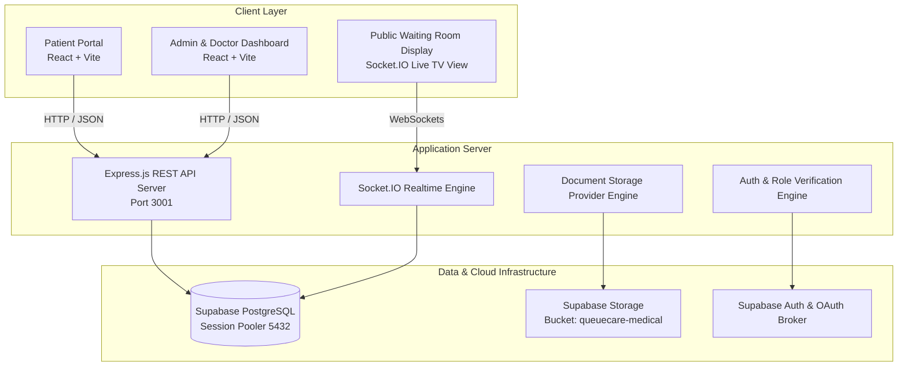
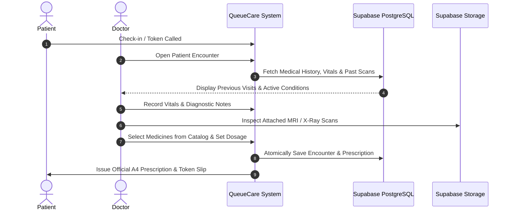
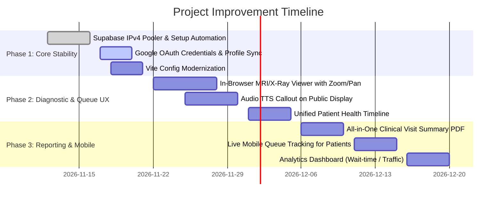

# Patient Queue & Clinic Management System
## System Architecture, Current Implementation & Proposed Improvement Plan

**Project:** QueueCare / Neuro Spine Care Center  
**Date:** November 17, 2026  
**Status:** Backend & Database Operational (Supabase PostgreSQL + Express API + React SPA)

## 1. Executive Summary

The **Patient Queue & Clinic Management System** is an enterprise-grade Electronic Health Record (EHR) and clinic queue management platform designed for multi-clinic medical centers and specialist practices. The core application provides seamless appointment scheduling, real-time token queueing, clinical consultations, vitals tracking, digital prescriptions, private medical document uploads (including MRI and X-ray imaging), and itemized billing.

The system is fully operational locally, with the backend API powered by **Node.js/Express** connected to a cloud **Supabase PostgreSQL** database with Row-Level Security (RLS) and strict role-based access control (Admin, Doctor, Nurse, Receptionist, and Patient).

This document outlines the **current architectural capabilities**, assesses **clinical and diagnostic workflows** (including MRI/X-ray and appointment management), identifies **recent technical fixes**, and details a **prioritized roadmap of enhancements** to be executed in the next project phase.

---

## 2. System Architecture & Tech Stack

* **Frontend:** React 19, TypeScript, Vite, Tailwind CSS, TanStack Query, Radix UI.
* **Backend:** Node.js (v24), Express, WebSockets (Socket.IO).
* **Database & Cloud:** Supabase PostgreSQL (custom `queuecare` schema with 22 relational tables), Supabase Storage for private clinical media, and Supabase Auth.
* **Security & Compliance:** Role-based access control, encrypted session cookies, audit logs for all sensitive actions, and private temporary signed URLs for medical documents.

---

## 3. Deep Dive: Current Implementation vs. Proposed Enhancements

### 3.1 Medical Documents & Imaging (MRI, X-Ray, CT, Lab Reports)

#### Current Implementation
* **Database Representation:** Managed in the `patient_documents` table with explicit categorization:
  * `imaging_report` (X-rays, MRI scans, CT scans, ultrasounds)
  * `lab_report` (Blood work, pathology, biopsies)
  * `referral` and general `medical_document`
* **Private Storage Architecture:** Scans are stored in the private `queuecare-medical` Supabase storage bucket. Permanent public URLs are strictly forbidden. Access is provided only through **short-lived signed URLs (60-second expiration)** issued after server-side ownership checks.
* **File Validation:** Accepts PDF, JPEG, and PNG files up to 10 MB per file, with magic-byte MIME validation on the server to reject malicious file extensions.
* **Privacy Toggle:** Staff can toggle `patient_visible` so internal clinical scan notes remain private until released by the doctor.

#### Proposed Improvements
1. **In-Browser Medical Scan Diagnostic Viewer:**
   * Build an interactive viewer for medical scans featuring pan, zoom, contrast adjustment, and rotation controls so doctors can inspect high-resolution MRI and X-ray slices directly within the consultation workflow.
2. **Categorized Patient Document Gallery:**
   * Introduce dedicated filter tabs on patient profiles (`All`, `MRI & X-Rays`, `Lab Tests`, `Prescriptions`) with thumbnail previews.
3. **Multi-File Batch Upload for Scan Series:**
   * Enable uploading complete MRI slice series (5–10 scans per study) under a unified study label (e.g., *"Cervical Spine MRI - Series 2"*).

---

### 3.2 Appointments & Real-Time Token Queueing

#### Current Implementation
* **Atomic Token Allocation:** Every appointment booking transaction atomically issues a date-scoped sequential token (e.g., `A-01`, `A-02`) tied to the selected clinic.
* **Doctor Split-Shift Availability:** Supports weekly multi-interval shifts (e.g., Morning: 09:00–13:00, Evening: 17:00–21:00) with conflict validation preventing cross-clinic booking overlaps.
* **Triage & Priority Tagging:** Appointments can be categorized into `Routine`, `Urgent`, or `Critical`, with operational tags (`needs_assistance`, `special_attention`, `follow_up`).
* **Sanitized Public Display:** Dedicated monitor display (`/public-display`) shows currently called tokens without exposing private patient names or medical conditions.
* **Printable PDF Token:** Instant download of patient token slips containing QR verification, clinic address, and appointment window.

#### Proposed Improvements
1. **Audio / Text-to-Speech (TTS) Token Announcer:**
   * Integrate synthesized voice announcements (*"Token A-14, please proceed to Consultation Room 1"*) with an alert chime on the Public Display.
2. **Mobile Live Queue Tracker:**
   * Provide a responsive patient tracking URL (*"You are #3 in line. Estimated wait: 12 minutes"*) so patients are not confined to crowded waiting areas.
3. **Automated Doctor Leave & Conflict Resolution:**
   * Automated detection of existing appointments when a doctor requests leave, providing one-click batch rescheduling or notifications.

---

### 3.3 Clinical Records & Electronic Health Records (EHR)

#### Current Implementation
* **Structured Clinical Encounters:** Encounters track Chief Complaint, Examination Notes, Clinical Diagnosis, and Private Working Notes.
* **Vitals Recording:** Captures Blood Pressure (Systolic/Diastolic), Pulse Rate, Temperature, Weight, Height, and derived BMI.
* **Medicine Catalog & Prescription Engine:** Doctor selects from a pre-configured library with dosage forms (tablets, syrups, injections), frequencies, strengths, and durations.
* **A4 Print Engine:** Formats a doctor-branded physical prescription ready for printing.

#### Proposed Improvements
1. **Unified Longitudinal Patient Health Timeline:**
   * A unified visual chronological timeline combining:
     $$\text{Visit Date} \longrightarrow \text{Vitals} \longrightarrow \text{Diagnosis} \longrightarrow \text{Imaging (MRI/X-Ray)} \longrightarrow \text{Prescription}$$
2. **Comprehensive Clinical Visit Summary (PDF Report):**
   * Generate an all-in-one official medical report summarizing vitals, doctor notes, attached lab/imaging results, and treatment plan.
3. **Side-by-Side Imaging Comparison:**
   * Comparison view allowing doctors to view previous X-rays/MRIs alongside current scans to track patient recovery over time.

---

## 4. Recent Technical Fixes & Stability Upgrades

| Area | Challenge Identified | Solution Implemented |
| :--- | :--- | :--- |
| **Database Connectivity** | Supabase direct connection (`db.<ref>.supabase.co`) is IPv6-only, causing `ENOTFOUND` crashes on IPv4 networks. | Switched to Supabase **Session Pooler (`aws-1-us-east-1.pooler.supabase.com:5432`)** supporting full IPv4 routing and transactional reliability. |
| **Schema Migration** | 11 sequential SQL migrations required manual execution. | Consolidated all migrations into a unified, reproducible script (`supabase/combined_migrations.sql`) for one-click deployment. |
| **Admin Bootstrap** | Fresh databases lack administrative users and primary clinic data. | Automated clinic seeding and administrative password hashing (`scripts/supabase-setup.mjs`). |
| **Vite Tooling** | Outdated `vite-tsconfig-paths` generated build warnings on newer Vite engines. | Modernized path resolution configuration to align with native Vite standards. |

---

## 5. Phased Project Roadmap

### Phase 1: Infrastructure & Authentication (Current Week)
* Complete Google Cloud OAuth credentials integration for verified patient sign-in.
* Finalize environment profiles and secure token handling.
* Deprecate legacy bundler plugins in `vite.config.ts`.

### Phase 2: Diagnostic Imaging & Queue Audio (Weeks 2–3)
* Implement the in-browser medical scan viewer for MRI, X-ray, and CT scans.
* Build the Web Speech API Text-to-Speech token callout on the public TV display.
* Deploy the interactive Patient Medical Timeline view on the doctor consultation screen.

### Phase 3: Comprehensive Reports & Mobile Tracking (Weeks 3–4)
* Implement the All-in-One Comprehensive Clinical Visit Summary PDF export.
* Build a lightweight patient mobile queue status screen.
* Integrate operational analytics charts (peak clinic hours, average consultation duration, patient flow rates).

---

## 6. Conclusion

The foundational architecture of the Patient Queue System is robust, featuring an isolated cloud PostgreSQL database on Supabase, an authenticated Node.js API, and a secure document storage layer. By implementing the proposed diagnostic imaging viewer, audio queue announcements, and comprehensive clinical reporting, the project will transition from a functional prototype into a hospital-ready clinical management system.

---
*Report generated and submitted for academic review.*
