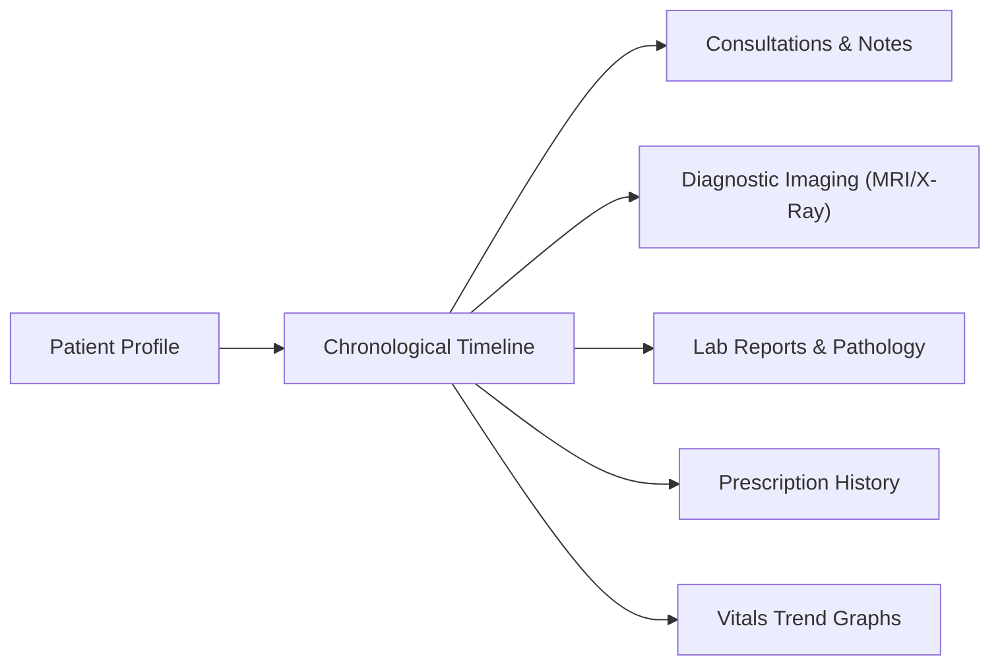
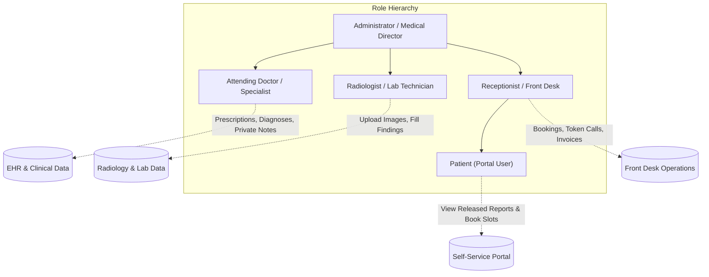
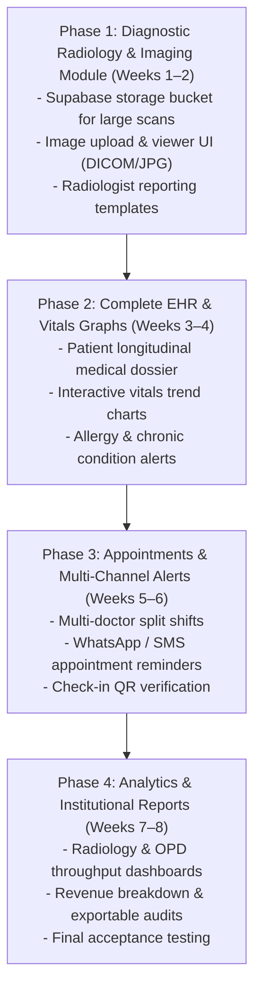

# Software Requirements Specification (SRS)
## Clinic Management, Diagnostic Imaging & Electronic Health Records (EHR) System

---

## 1. Executive Summary & Objective

This document defines the functional and non-functional requirements to evolve the **QueueCare / Neuro Spine Care Center** web application into a clinical-grade **Clinic Management & Diagnostic Health System**. 

While the existing system already provides patient queueing, appointment booking, basic consultations, and invoicing, this specification outlines the additions necessary for:
1. **Comprehensive Diagnostic Imaging Management (X-Ray, MRI, CT Scans, Ultrasound)**.
2. **Complete Electronic Health Records (EHR) & Longitudinal Medical History**.
3. **Advanced Appointment Lifecycle & Automated Multi-Channel Reminders**.
4. **Clinical & Administrative Analytics / Reporting**.
5. **Multi-Role Security and Compliance Safeguards (HIPAA/GDPR alignment)**.

---

## 2. Gap Analysis: Current Baseline vs. Target State

| Feature Area | Current Baseline in Codebase | Target Requirement |
| :--- | :--- | :--- |
| **Medical Imaging (X-Ray, MRI)** | Generic file attachments up to 10 MB (PDF/JPG/PNG) | Dedicated Diagnostic Radiology Study management with high-res viewer, DICOM/JPEG support, radiologist impressions, and multi-file imaging series. |
| **Clinical Records** | Single-visit consultation form (vitals, diagnosis, prescription) | Unified Patient Longitudinal Health Record (EHR), chronological timeline, allergy & chronic condition alerts, vitals trend graphs. |
| **Appointments** | Date/slot booking with atomic queue token issuance | Multi-doctor scheduling, automated rescheduling/cancellation workflows, SMS/WhatsApp notifications, teleconsultation links. |
| **Clinic Reports & Analytics**| Basic CSV export of appointments and billing | Interactive executive dashboard, daily OPD throughput, diagnostic department utilization, revenue and outstanding balance tracking. |
| **Roles & Permissions** | Admin, Receptionist, Nurse, Patient | Dedicated **Radiologist / Lab Technician** and **Doctor Specialist** roles with fine-grained access control. |

---

## 3. Detailed Functional Modules & Requirements

### Module 1: Diagnostic Imaging & Radiology Management (X-Ray, MRI, CT)

#### 1.1 Study & Series Management
- **Study Creation:** Ability for receptionist or doctor to order diagnostic studies (e.g., *Cervical Spine MRI*, *Chest X-Ray PA View*, *Lumbar CT Scan*).
- **Study Metadata:** Modality (MRI, X-Ray, CT, Ultrasound), Study Date, Body Region, Referring Physician, Performing Radiologist, Status (*Ordered*, *In Progress*, *Reported*, *Reviewed*).
- **High-Capacity File Ingestion:** 
  - Support high-resolution medical image files (JPEG, PNG, TIFF, and DICOM `.dcm`).
  - Chunked and resumable uploads for large imaging series (up to 100 MB per study).
  - Secure storage in private Supabase Storage buckets with short-lived, signed URLs (no public links).

#### 1.2 Web-Based Medical Image Viewer
- In-browser viewer with:
  - Zoom, Pan, Invert, and Contrast/Brightness adjustment (Window/Level presets for Bone, Soft Tissue, Lung).
  - Measurement tools (linear distance in mm, angle measurement for spine curvature/Cobb angle).
  - Side-by-side comparison (e.g., Pre-Op MRI vs. Post-Op MRI).

#### 1.3 Radiology Reporting & Findings
- Structured radiology report templates:
  - *Clinical Indication / History*
  - *Technique / Sequence*
  - *Detailed Findings*
  - *Impression / Conclusion*
- Digital signature and timestamp of the reporting radiologist.
- Doctor acknowledgment workflow (doctor reviews and marks study as "Reviewed").
- Patient release control: Reports are marked *Doctor Confidential* until officially released for patient portal viewing.

---

### Module 2: Longitudinal EHR & Clinical Records



#### 2.1 Complete Patient Medical Dossier
- **Patient Master Index (PMI):** Demographics, Blood Group, Emergency Contacts, Identification / National ID, Insurance details.
- **Medical Alerts Banner:** Prominently displays drug allergies, severe conditions (e.g., *Hypertension*, *Type II Diabetes*, *Post-Spinal Fusion*), and active warnings on every clinical page.
- **Vitals Tracking & Trend Graphs:** Interactive visual charts for Blood Pressure, Heart Rate, SpO2, Temperature, Weight, and BMI over successive visits.

#### 2.2 Comprehensive Visit Summaries & Consultations
- Structured SOAP notes (*Subjective, Objective, Assessment, Plan*).
- Integrated Medicine Library with dosage, frequency, route, and duration.
- Differential diagnoses using standard coding (ICD-10 optional search).
- Exportable and printable official consultation reports on branded clinic letterhead.

#### 2.3 Lab & Pathology Records
- Support for structured blood tests, urine tests, CSF analysis, and biopsy reports.
- Normal vs. abnormal reference range highlighting (e.g., high ESR or CRP highlighted in red).

---

### Module 3: Advanced Appointment Lifecycle & Communication

#### 3.1 Doctor Availability & Shift Engine
- Split-shift doctor hours (e.g., Morning 09:00–13:00, Evening 17:00–21:00).
- Multi-clinic schedule support with automatic cross-clinic collision prevention.
- Planned leave and emergency off-day management with automatic appointment rescheduling alerts.

#### 3.2 Appointment Booking & Token Engine
- Patient self-service booking portal with real-time slot selection based on clinic slot intervals (10, 15, 20, or 30 minutes).
- Walk-in / emergency token generation for front-desk receptionists.
- Atomic appointment token issuance tied to today's live queue.
- Verifiable downloadable PDF tokens with QR codes for fast clinic check-in.

#### 3.3 Automated Multi-Channel Notifications
- **Triggers:** Booking confirmation, appointment reminder (24h and 2h prior), doctor running late alert, queue position updates ("You are 3rd in line"), report ready notification.
- **Channels:** 
  - In-app notification center.
  - Email (via Resend integration).
  - WhatsApp / SMS integration (Twilio / Meta WhatsApp Business API).

---

### Module 4: Operational Reports & Clinic Analytics

#### 4.1 Daily Clinic Operational Dashboard
- Real-time queue monitor (patients waiting, currently serving, completed, no-shows, average consultation duration).
- Doctor performance metrics (patients consulted per shift, average consultation minutes).

#### 4.2 Diagnostic & Radiology Utilization Reports
- Number of X-Rays, MRIs, and ultrasounds performed per day/week/month.
- Turnaround time (time from study order to completed radiology report).

#### 4.3 Financial & Revenue Reporting
- Daily cash collection, bank transfers, and online payments.
- Outstanding patient balances and unpaid invoice tracking.
- Departmental revenue split (OPD Consultations vs. Radiology vs. Procedures).
- Audited CSV and PDF export with spreadsheet formula injection protection.

---

### Module 5: Role-Based Access Control (RBAC) & Security



#### Permission Matrix

| Resource / Capability | Admin | Doctor | Radiologist | Receptionist | Patient |
| :--- | :---: | :---: | :---: | :---: | :---: |
| Book / Reschedule Appointments | ✅ | ✅ | ❌ | ✅ | ✅ (Own only) |
| Call & Advance Live Queue | ✅ | ✅ | ❌ | ✅ | ❌ |
| Create / Edit Clinical Consultations | ✅ | ✅ | ❌ | ❌ | ❌ |
| Upload & View X-Ray / MRI Images | ✅ | ✅ | ✅ | ❌ | ✅ (Released only) |
| Author Radiology Findings & Reports | ✅ | ✅ | ✅ | ❌ | ❌ |
| View Financials & Generate Invoices | ✅ | ❌ | ❌ | ✅ | ✅ (Own receipts) |
| System Configuration & User Management | ✅ | ❌ | ❌ | ❌ | ❌ |

---

## 4. Proposed Database Schema Extensions

To support these requirements, the following new relational tables are specified for the Supabase PostgreSQL backend:

```sql
-- 1. Diagnostic Imaging Studies (X-Ray, MRI, CT)
CREATE TABLE queuecare.imaging_studies (
    id TEXT PRIMARY KEY,
    patient_id TEXT NOT NULL REFERENCES queuecare.users(id),
    appointment_id TEXT REFERENCES queuecare.appointments(id),
    clinic_id TEXT NOT NULL REFERENCES queuecare.clinics(id),
    modality TEXT NOT NULL CHECK (modality IN ('X-Ray', 'MRI', 'CT', 'Ultrasound')),
    body_part TEXT NOT NULL, -- e.g. 'Cervical Spine', 'Chest', 'Lumbar'
    ordered_by TEXT NOT NULL REFERENCES queuecare.users(id),
    radiologist_id TEXT REFERENCES queuecare.users(id),
    status TEXT NOT NULL DEFAULT 'ordered' CHECK (status IN ('ordered', 'uploaded', 'reported', 'reviewed')),
    findings TEXT,
    impression TEXT,
    is_released_to_patient BOOLEAN NOT NULL DEFAULT FALSE,
    study_date TEXT NOT NULL,
    created_at TEXT NOT NULL,
    updated_at TEXT NOT NULL
);

-- 2. Diagnostic Image Files (Multi-frame series / scans)
CREATE TABLE queuecare.imaging_files (
    id TEXT PRIMARY KEY,
    study_id TEXT NOT NULL REFERENCES queuecare.imaging_studies(id) ON DELETE CASCADE,
    storage_path TEXT NOT NULL,
    file_name TEXT NOT NULL,
    mime_type TEXT NOT NULL,
    byte_size BIGINT NOT NULL,
    series_number INTEGER DEFAULT 1,
    instance_number INTEGER DEFAULT 1,
    created_at TEXT NOT NULL
);

-- 3. Patient Vitals Tracking
CREATE TABLE queuecare.patient_vitals (
    id TEXT PRIMARY KEY,
    patient_id TEXT NOT NULL REFERENCES queuecare.users(id),
    recorded_by TEXT NOT NULL REFERENCES queuecare.users(id),
    recorded_at TEXT NOT NULL,
    systolic_bp INTEGER,
    diastolic_bp INTEGER,
    heart_rate INTEGER,
    temperature_c NUMERIC(4,1),
    spo2_percentage INTEGER,
    weight_kg NUMERIC(5,2),
    height_cm NUMERIC(5,2),
    notes TEXT
);

-- 4. Chronic Conditions & Allergies
CREATE TABLE queuecare.patient_alerts (
    id TEXT PRIMARY KEY,
    patient_id TEXT NOT NULL REFERENCES queuecare.users(id),
    alert_type TEXT NOT NULL CHECK (alert_type IN ('allergy', 'chronic_condition', 'warning')),
    title TEXT NOT NULL,
    severity TEXT NOT NULL CHECK (severity IN ('low', 'medium', 'high', 'critical')),
    created_at TEXT NOT NULL
);
```

---

## 5. Phased Implementation Roadmap



---

## 6. Submission & Verification Checklist

- [ ] Requirements specification presented and approved by stakeholder/instructor.
- [ ] Database migration scripts prepared additively in `supabase/migrations/`.
- [ ] Role-Based Access Control verified with zero data leakage between doctor private notes and public tokens.
- [ ] High-resolution image upload verified up to 100 MB with encrypted private storage.
- [ ] Printable A4 consultation & radiology summaries rendered without web browser UI chrome.
